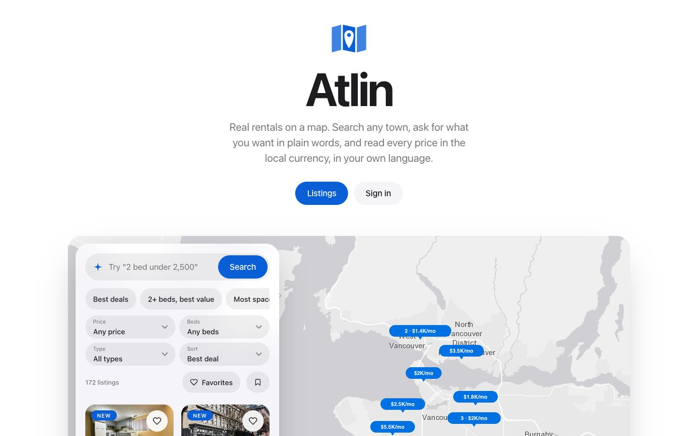
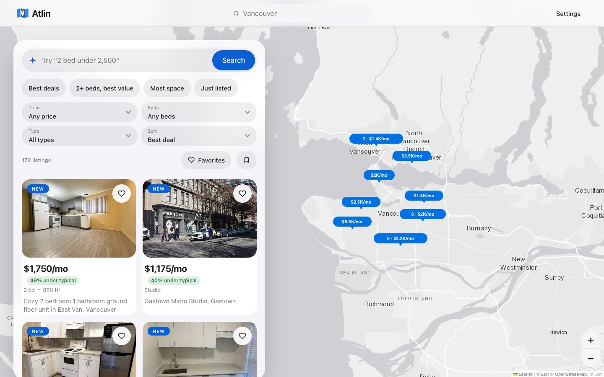
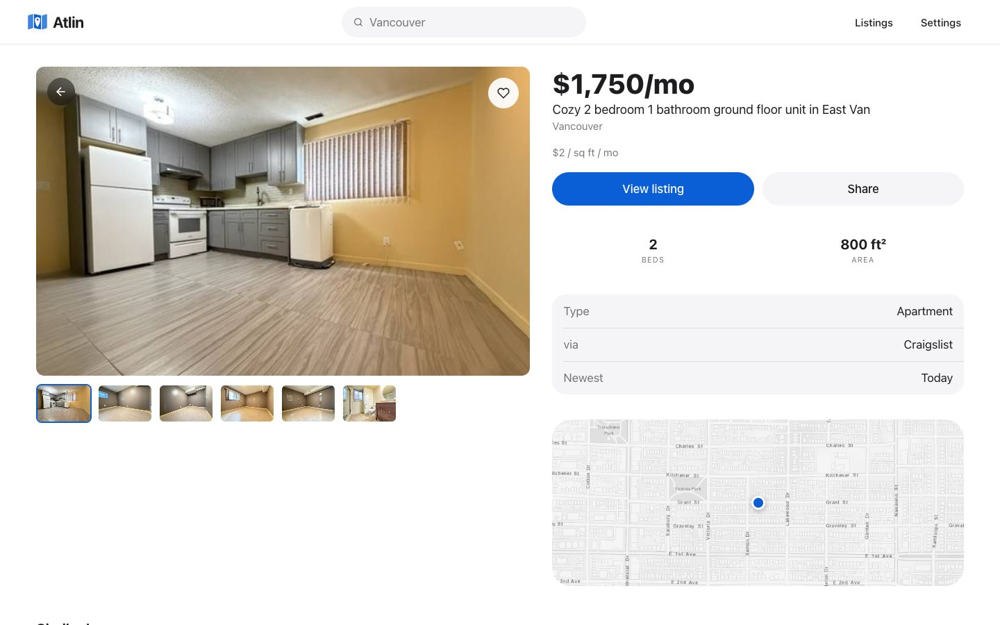
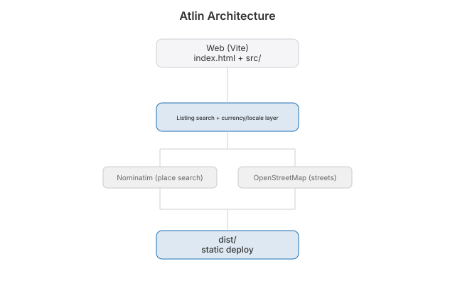

# Atlin


 [](https://github.com/nulljosh/atlin)

**Live:** https://atlin.jaybulb.com

**Terminal:** `swift build && ./.build/debug/atlin-tui "Vancouver"` — see [tui/](tui/)

Real homes on a map, ranked by deal.

Type a city. Atlin shows what is for rent or for sale there, scores each home against the typical price for its size, and puts the best deals first. Every price in the local currency, every label in your language.



| Browse | Listing |
|---|---|
|  |  |


## Features

- Real homes for rent and for sale from Craigslist, HousingFeed and RentCast
- Every home scored against the typical price for its size, best deals first
- Ad cards filtered out; homes without photos show a street map
- Any place on earth, prices in the local currency, ft² or m² per country
- 27 languages, right-to-left included, picked from your browser
- Search in plain words: "2 bed under 2,500"
- Sign in with Apple, Google or email; saved homes sync to iPhone and Mac
- iPhone and Mac app from one SwiftUI target

## Run

```bash
cp .env.example .env   # optional: VITE_API_URL overrides the jaybulb-api Worker
npm install && npm run dev
npm run build
node src/data/listings.test.mjs
```

## Data

`functions/api/listings.js` asks Craigslist, HousingFeed and RentCast at once, merges and dedupes them, and caches the result for a day. With no live source for a place, the app shows sample homes and says so.

## Source

[github.com/nulljosh/atlin](https://github.com/nulljosh/atlin)

## License

MIT 2026 Joshua Trommel

[Technical whitepaper](WHITEPAPER.md)

## API and agent tools

An agent can drive this app. [`docs/API.md`](docs/API.md) lists the HTTP surface, where there
is one, and the WebMCP tools registered on `document.modelContext`. Tools come in three kinds:
read-only, writes you can undo, and the few that ask a human first.

## Architecture


